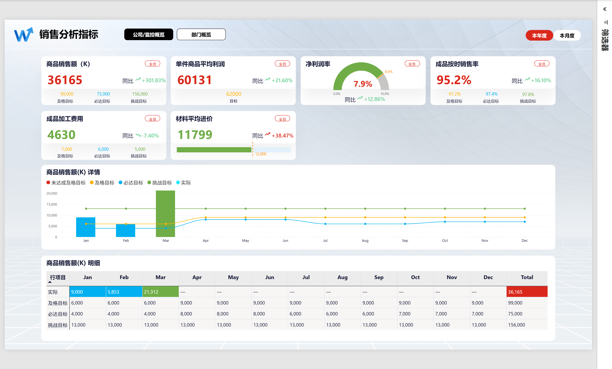
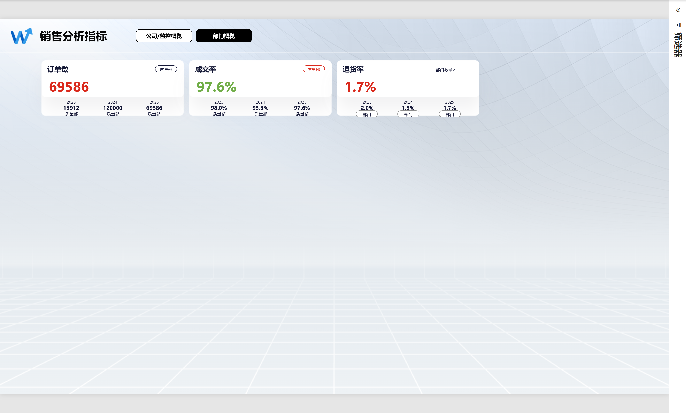
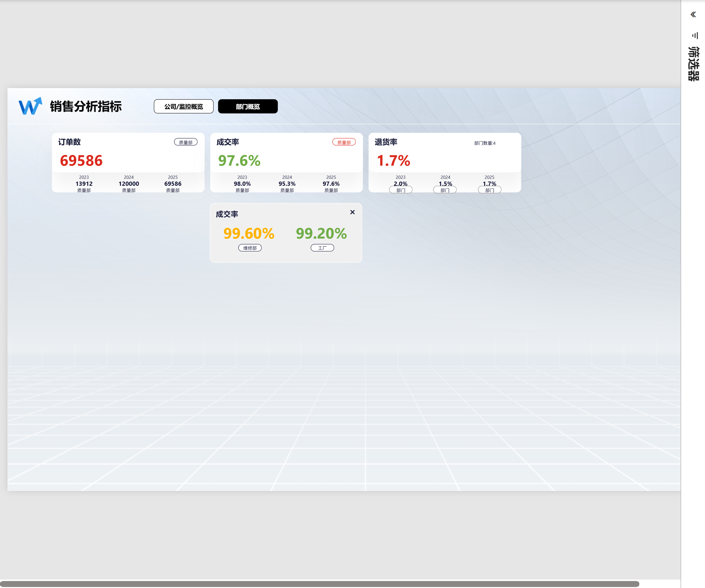

# Power BI 销售分析看板

这是培训考核项目。源 Excel 经过整理、建立表关系和 DAX 指标计算，形成公司与部门两页交互报表。公司页展示六项指标，部门页展示订单数、成交率和退货率，支持周期切换与详情展开。

## 可以从这些文件开始查看

| 内容 | 文件 | 用途 |
| --- | --- | --- |
| 正式报表 | [销售分析看板.pbix](Report/销售分析看板.pbix) | 使用 Power BI Desktop 查看报表、交互与模型。 |
| 可编辑工程 | [销售分析看板.pbip](Report/销售分析看板.pbip) | 与旁边的 Report、SemanticModel 文件夹一起打开，查看页面配置、Power Query 和 DAX。 |
| 项目说明 | [项目完整说明.html](PPT/汇报辅助/项目完整说明.html) | 查看报表形成过程。下载完整仓库后用浏览器打开。 |
| 执行要求与检查 | [项目执行与需求检查.html](PPT/汇报辅助/项目执行与需求检查.html) | 对照需求、实现位置、检查结果和证据。下载完整仓库后用浏览器打开。 |
| 汇报材料 | [截图讲解版 PPT](PPT/销售分析项目汇报_截图讲解版.pptx) | 结合报表截图查看项目说明。 |
| 刷新文件 | [刷新数据](Report/刷新数据/)与[换电脑刷新说明](Report/换电脑刷新说明.md) | 设置源数据目录并刷新。 |

## 两页报表的效果如下

### 公司页展示总体指标

### 部门页展示各部门的指标

### 详情展示部门数据

## 下载后可以这样打开

1. 下载整个仓库，保留目录结构；使用 Power BI Desktop 打开 PBIX，或者打开 PBIP 工程。
2. 如需刷新，在 Power Query 的“管理参数”中，将 `DataSourceDirPath` 改为本机 `Report/刷新数据` 文件夹的绝对路径。
3. 该文件夹内的 Excel 和预期结果 JSON 必须一起保留。关闭并应用，然后刷新报表。

预期结果 JSON 用于结果检查。更改 Excel 后，需要重新独立计算并核对预期结果，不能直接用报表计算值覆盖检查依据。原说明中的开发目录属于当时的本地路径，本仓库以 `Report/刷新数据` 为准。

## 工程与材料分别保存在这些目录

`Report` 保存正式报表、可编辑模型与刷新文件；`PPT` 保存一份汇报材料及说明文档；`preview` 保存报表截图。

材料展示的是培训数据下的开发与检查结果。阶段检查记录对应当时的版本；截图用于展示页面及交互状态。
